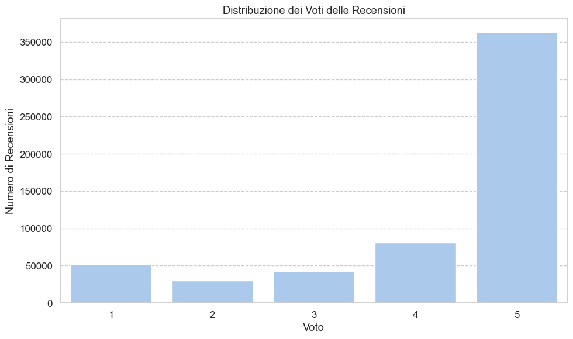
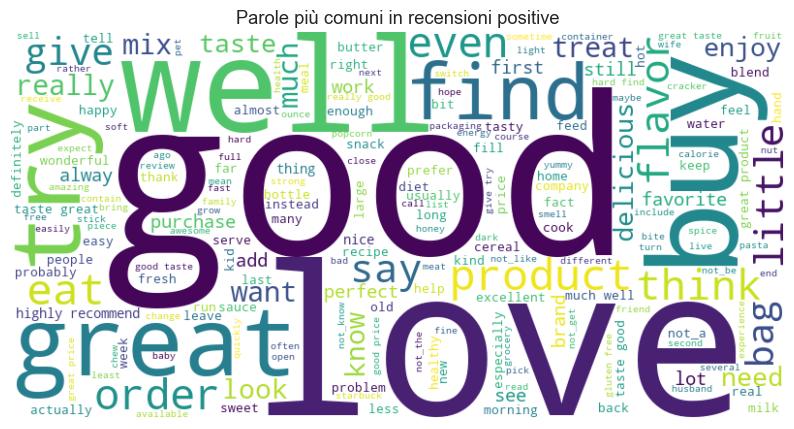
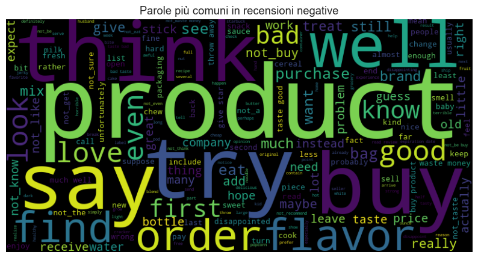
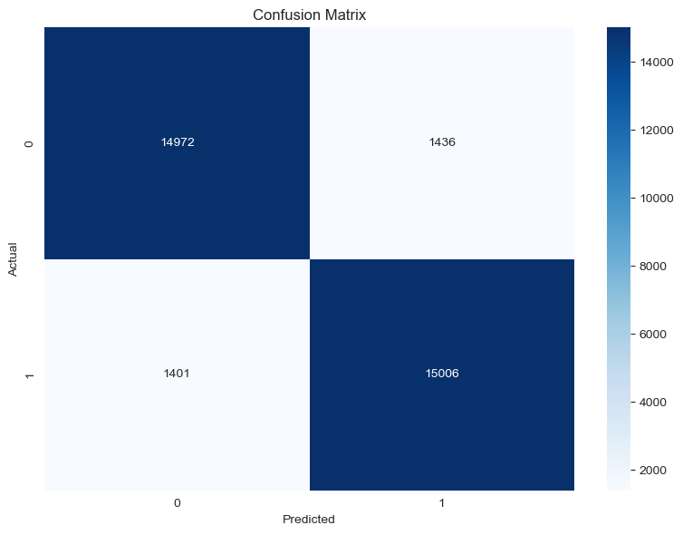
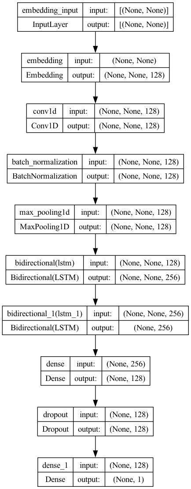
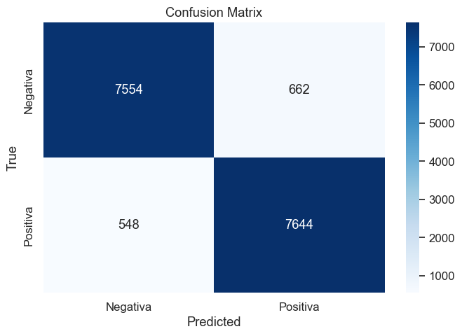
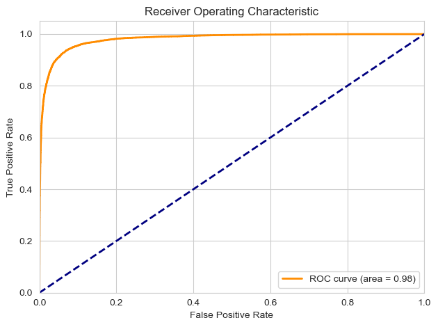

**Author:** Giuseppe Muschetta  
**University:** University of Pisa  
**Degree:** M.Sc. in Data Science & Business Informatics  
**Course:** Text Analytics  
**Supervisor:** Prof. Laura Pollacci  
**Academic year:** 2023–2024

# Amazon Review Sentiment: From TF-IDF to Transformers

**A complete NLP study connecting corpus exploration, linguistic preprocessing, classical machine learning, a custom CNN–BiLSTM and DistilBERT fine-tuning.**

Starting from **568,454 Amazon reviews**, this project develops a balanced sentiment-classification study and investigates four modelling approaches: Multinomial Naïve Bayes, a linear SVM, a custom convolutional–recurrent neural network and a pretrained transformer.

The work was developed for the **Text Analytics course in the M.Sc. in Data Science & Business Informatics at the University of Pisa**, under the supervision of **Prof. Laura Pollacci**. It combines the design of a custom text-processing pipeline with model development and evaluation through classification reports, confusion matrices, ROC curves and precision–recall analysis.

**A central result:** the custom **2.66-million-parameter CNN–BiLSTM** records **92.63% accuracy on its held-out test set**, using Word2Vec embeddings trained on the review corpus. The DistilBERT experiment records **93.27% validation accuracy**, adding a complementary transfer-learning approach.

[Read the technical report](Report.pdf) · [View the presentation](Presentazione.pdf) · [Read the project proposal](project_proposal.pdf)

## Project at a glance

| Dimension | Scope |
| :--- | :--- |
| Original corpus | **568,454 reviews**, 10 columns and **74,258 unique product IDs** |
| Observation period | 1999–2012 |
| Classification task | Rating-derived binary sentiment: negative vs positive |
| Balanced study dataset | **164,074 reviews**, with **82,037 per class** |
| Cleaned vocabulary | **139,099 unique tokens** recorded during preparation |
| Classical methods | TF-IDF, chi-square feature selection, MultinomialNB and LinearSVC |
| Neural methods | Domain-trained Word2Vec, Conv1D and two bidirectional LSTM layers |
| Transfer learning | DistilBERT fine-tuning for binary classification |
| Documentation | Six notebooks, two helper scripts, a 27-page report and an 18-slide presentation |

## Understanding the corpus and defining the task

The data comes from the [Amazon Product Reviews dataset on Kaggle](https://www.kaggle.com/datasets/arhamrumi/amazon-product-reviews), corresponding to the Amazon Fine Food Reviews corpus.

The exploration examines rating frequencies, review lengths, product coverage and temporal patterns. The original ratings are strongly skewed toward five-star reviews, making class balance an explicit modelling decision.

*Original rating distribution, extracted from the saved exploratory notebook output.*

The binary target is defined as follows:

| Rating | Sentiment label | Original reviews |
| :--- | :--- | ---: |
| 1–2 stars | Negative (`0`) | 82,037 |
| 3 stars | Excluded from the binary task | 42,640 |
| 4–5 stars | Positive (`1`) | 443,777 |

Random undersampling of the positive class produces the balanced dataset of **164,074 reviews**. The rating determines the label; the models use the review text as their input.

## Custom linguistic preprocessing

The shared processing script prepares the text through a sequence of operations:

- Strip HTML and remove URLs, email addresses, numbers and punctuation.
- Normalize case and expand English contractions.
- Apply spaCy tokenization, lemmatization and part-of-speech filtering.
- Filter standard and domain-specific stopwords.
- Bind negation markers such as `not`, `no` and `never` to the following token, preserving compounds such as `not_good`.
- Include phrase-detection logic through Gensim.

The resulting sentiment-specific vocabulary is visible in the saved wordclouds:

| Positive reviews after preprocessing | Negative reviews after preprocessing |
| :---: | :---: |
|  |  |

*Both figures are extracted directly from the saved preparation notebook outputs. Their original Italian titles are retained.*

## Recorded model results

| Model | Recorded accuracy | Evaluation partition | Reviews evaluated | ROC AUC in saved figure |
| :--- | ---: | :--- | ---: | ---: |
| Multinomial Naïve Bayes | **89.23%** | Test set from stratified 80/20 split | 32,815 | 0.96 |
| Linear SVM | **91.35%** | Test set from stratified 80/20 split | 32,815 | 0.97 |
| Custom CNN–BiLSTM | **92.63%** | Test set from 80/10/10 train/validation/test split | 16,408 | 0.98 |
| DistilBERT | **93.27%** | Validation set from stratified 80/20 split | 32,815 | 0.98 |

*These are the evaluations saved in the supplied notebooks. The partition and sample count identify the scope of each result; ROC AUC values are rounded as displayed in the original figures.*

### Classical machine learning: sparse representations and cross-validation

The Naïve Bayes and linear SVM experiments combine:

1. **TF-IDF unigram and bigram features.**
2. **Chi-square feature selection** through `SelectKBest`.
3. **Five-fold cross-validation** with a scikit-learn pipeline.

Vectorization and supervised feature selection are fitted within the cross-validation folds. The notebooks also include complete-pipeline persistence and prediction examples on new review text.

On the same recorded test partition, **LinearSVC improves accuracy by approximately 2.12 percentage points over MultinomialNB**. Its saved ROC AUC and average precision are both approximately **0.97**.

*LinearSVC test evaluation. Rows are actual labels and columns are predicted labels; `0` denotes negative sentiment and `1` positive sentiment.*

### Custom deep learning: Word2Vec + CNN + BiLSTM

The custom network connects local phrase extraction with bidirectional sequence modelling:

| Component | Configuration |
| :--- | :--- |
| Word embeddings | Trainable **128-dimensional Word2Vec** embeddings learned from training reviews |
| Sequence representation | Vocabulary capped at 15,000 words; padded 100-token inputs |
| Local feature extraction | Conv1D with **128 filters** and kernel size **3** |
| Intermediate processing | Batch normalization and max pooling |
| Sequential modelling | **Two bidirectional LSTM layers**, with 128 units per direction |
| Classifier | Dense layer with 128 units, dropout and a sigmoid output |
| Training controls | RMSprop, L2 regularization, learning-rate reduction and early stopping |
| Model size | **2,660,353 total parameters** |

The Word2Vec representations are learned from the training reviews and used to initialize the neural embedding layer. The saved training run completes nine epochs and records **92.63% accuracy on 16,408 test reviews**.

  

*Architecture diagram extracted from page 23 of the original report. [View the full-size diagram](assets/figures/cnn_bilstm_architecture.png).*

*Confusion matrix corresponding to the saved evaluation of the newly trained custom model.*

### Transformer transfer learning: DistilBERT

The transformer experiment adapts Hugging Face's **`distilbert-base-uncased`** to binary sentiment classification.

Its implementation uses 128-token inputs and attention masks, AdamW with a learning rate of `5e-5`, a linear learning-rate scheduler and gradient clipping. Training uses PyTorch with Apple Metal Performance Shaders in the recorded environment.

The saved validation evaluation reaches **93.27% accuracy** on **32,815 reviews**, with a plotted **ROC AUC of 0.98**.

*ROC curve extracted from the saved transformer notebook output.*

## Skills demonstrated

| Competency | Evidence in the project |
| :--- | :--- |
| Corpus analysis | Exploring review distributions, product coverage, text length and temporal trends |
| NLP pipeline design | Custom cleaning, linguistic normalization, stopword handling and negation-aware tokens |
| Classical text classification | Sparse representations, supervised feature selection and cross-validation pipelines |
| Neural architecture design | Combining domain-trained embeddings, convolutions and bidirectional recurrence |
| Transfer learning | Fine-tuning a pretrained transformer with tokenization, attention masks and training controls |
| Evaluation and communication | Classification reports, confusion matrices, ROC/PR curves, a technical report and a presentation |

## Explore the repository

| File | Purpose |
| :--- | :--- |
| [`Data_Understading.ipynb`](notebooks_and_scripts/Data_Understading.ipynb) | Corpus statistics, rating distributions, product coverage and temporal exploration |
| [`Data_Preparation.ipynb`](notebooks_and_scripts/Data_Preparation.ipynb) | Binary labels, class balancing, text processing and sentiment wordclouds |
| [`MultinomialNB.ipynb`](notebooks_and_scripts/MultinomialNB.ipynb) | TF-IDF/chi-square pipeline, Naïve Bayes and saved evaluation |
| [`LinearSVC.ipynb`](notebooks_and_scripts/LinearSVC.ipynb) | Linear SVM pipeline, cross-validation and saved evaluation |
| [`Deep_learning.ipynb`](notebooks_and_scripts/Deep_learning.ipynb) | Word2Vec embeddings, custom CNN–BiLSTM and saved training/test results |
| [`DistilBERT.ipynb`](notebooks_and_scripts/DistilBERT.ipynb) | Transformer fine-tuning and saved validation results |
| [`clean_text_script.py`](notebooks_and_scripts/clean_text_script.py) | Shared text-cleaning and normalization functions |
| [`count_and_wordclouds.py`](notebooks_and_scripts/count_and_wordclouds.py) | Token-frequency analysis and wordcloud generation |
| [`environment.yml`](notebooks_and_scripts/environment.yml) | Original Conda environment export, including Apple/macOS-specific tooling |
| [`Report.pdf`](Report.pdf) | Complete methodology, model descriptions and analysis |
| [`Presentazione.pdf`](Presentazione.pdf) | Eighteen-slide presentation of the project |
| [`project_proposal.pdf`](project_proposal.pdf) | Original research objectives and project plan |
| [`assets/figures/`](assets/figures/) | Seven selected figures extracted from the original report and saved notebook outputs |

The repository contains the notebooks, helper scripts and project documentation. The raw corpus is available from the linked dataset source; prepared CSV files and trained model checkpoints are referenced by the notebooks and are not bundled here.

**Core tools:** Python, pandas, scikit-learn, spaCy, NLTK, Gensim, TensorFlow/Keras, PyTorch, Hugging Face Transformers, Matplotlib, Seaborn and WordCloud.
